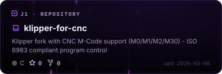
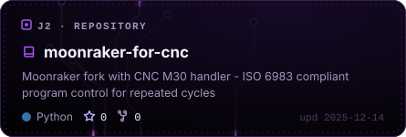

<!--
  Skin: circuit-violet (Lila/Schwarz). Andere Skins: siehe SKINS.md
  (circuit | fg | fg-light | aurora | broadcast | terminal | paper) — einfach "circuit-violet" unten ersetzen.
-->

  
  

  
  

