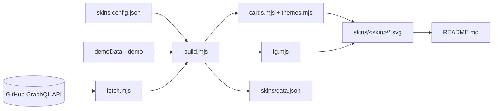
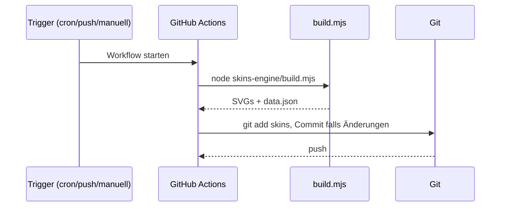

# Architektur

[← Zurück zur README](../README.md)

## Überblick

Das Repository ist ein GitHub-Profil-Repository. Ein Node.js-Skript erzeugt statische SVG-Karten, die die `README.md` per relativem Pfad einbindet. Es gibt keinen Server und keine Laufzeitabhängigkeiten.

## Komponenten

| Komponente | Datei | Aufgabe |
|---|---|---|
| CLI / Orchestrierung | `skins-engine/build.mjs` | Config laden, Daten holen, Skins rendern, Dateien schreiben; Farbvarianten (`circuit-violet`) per Farbtausch |
| Datenabruf | `lib/fetch.mjs` | Eine GraphQL-Query, Sprachanteile, Contribution-Streaks, Pins |
| Themes | `lib/themes.mjs` | Design-Tokens, `frame()`, `label()` je Skin |
| Standard-Karten | `lib/cards.mjs` | `banner`, `stats`, `languages`, `activity`, `repo` |
| FG-Karten | `lib/fg.mjs` | Eigenes Design inkl. `capabilities`, Fonts eingebettet |
| Hilfen | `lib/util.mjs` | `esc`, `textWidth`, `truncate`, `wrap`, `fmt`, `rng`, Icons, `svgDoc` |
| Fonts | `fonts/fg-fonts.mjs` | Base64-Fontsubsets und Breitentabellen |
| CI | `.github/workflows/profile-skins.yml` | Zeitgesteuertes Rendern und Commit |

## Datenfluss

## CI-Ablauf

## Designentscheidungen

- Textbreite wird geschätzt (Standard-Skins) bzw. aus Font-Advance-Widths berechnet (FG-Skins).
- Dekoration nutzt einen seeded Zufallsgenerator, damit Läufe reproduzierbare SVGs liefern.
- Private Repos/Beiträge fließen nur als Zahlen ein, Namen erscheinen nie auf Karten.
- Sprachanteile gewichten standardmäßig pro Repository (`languageWeighting`: `perRepo` oder `bytes`).
